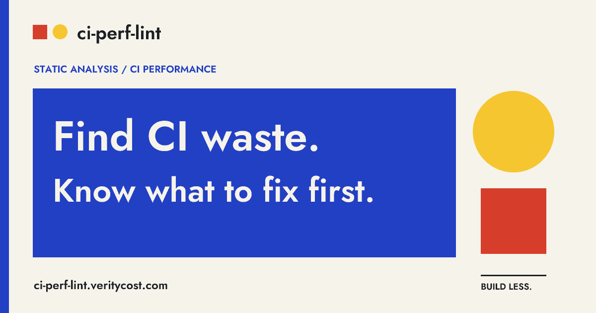

# CI Perf Lint

[](https://codspeed.io/yoshi-taka/ci-perf-lint?utm_source=badge)

<a href="https://ci-perf-lint.veritycost.com/">
  
</a>

Find CI waste. Know what to fix first.

CI Perf Lint scans CI workflows, source code, and tooling configuration for avoidable work—from redundant installs to expensive build patterns.

Get a prioritized improvement plan, not just warnings: where the waste is, what to change, and how to verify the result.

## Quick start

Run from your repository. No configuration required.

```sh
bunx ci-perf-lint
# or
npx ci-perf-lint
```

## Example

An abbreviated, illustrative report:

```text
Top findings

1. missing-path-ignore-for-non-code
   Context:
     A heavy workflow has no path filter for docs-only changes.
   Why it matters:
     Small documentation changes can still trigger expensive CI.
   Suggested action:
     Add safe path exclusions, or gate heavy jobs if checks
     are required.
   Measurement hint:
     Confirm docs-only changes skip heavy work without leaving
     required checks pending.

2. avoid-svg-component-imports
   Context:
     SVG component imports found in source files.
   Why it matters:
     Component transforms add work when asset URLs suffice.
   Suggested action:
     Use asset URL imports where component behavior
     is unnecessary.
   Measurement hint:
     Compare transform time and bundle/module counts.
```

CI YAML is only part of the picture. Slow builds and tests can come from source imports, package scripts, Dockerfiles, or tool configuration. CI Perf Lint checks those alongside your workflows.

## Why not just ask AI?

I build this tool with AI, too. In my experience, it rarely brings up niche CI performance optimizations unless I explicitly ask it to focus on that area.

CI Perf Lint encodes that specialized knowledge as repeatable static checks. It identifies patterns worth investigating and gives your agent concrete findings to work from.

Let the tool find the patterns. Let AI adapt the fixes to your repository.

```sh
bunx ci-perf-lint |
  claude -p "Review these findings and propose fixes"
```

The default output is an AI-ready handoff with prioritized findings, affected locations, suggested changes, and measurement hints.

## Coverage

GitHub Actions · Buildkite · CircleCI · GitLab CI

Checks cover triggers, concurrency, dependency caching, checkout and artifact overhead, duplicate work, Docker builds, and source/tooling performance patterns.

Depot workflows use GitHub Actions support. Individual rule coverage varies by platform.

Pointing the tool at a directory that is not a git repository but contains sibling repositories audits each repository separately, so root-level Gradle, Docker, and package signals stay scoped to the repository that owns them.

CircleCI orb sources are loaded from the public CircleCI registry so Docker and Gradle commands inside orb jobs and commands are visible.

[Browse the rules →](https://ci-perf-lint.veritycost.com/rules/)

## Usage

```sh
# Audit another repository
bunx ci-perf-lint /path/to/repo

# Export a shareable report
bunx ci-perf-lint --format markdown

# Export all findings as JSON
bunx ci-perf-lint --findings-only --format json

# Focus on workflows or repository source/tooling
bunx ci-perf-lint --workflow-only
bunx ci-perf-lint --repository-only

# Include broader suggestions
bunx ci-perf-lint --mode exploratory
```

By default, the report shows the top five rule groups. Use `--top N` to change the limit, or `--findings-only` for the full, ungrouped list. With `--findings-only`, an explicit `--top N` limits individual findings instead.

Strict mode is the default; exploratory mode includes broader suggestions.

Static analysis identifies opportunities, not guaranteed savings. Review changes and measure their effect.

Exit codes: `0` no findings · `1` findings · `2` CLI or target error.

See `bunx ci-perf-lint --help` for all options.

## Development

```sh
bun install
bun run lint
bun run audit:static
bun run test
```

[Adding a rule](https://github.com/yoshi-taka/ci-perf-lint/blob/main/docs/adding-a-rule.md)
